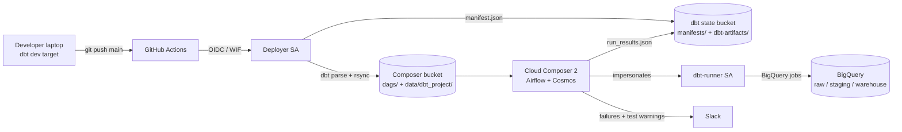

> **Public preview repository.** This document is complete. Core code is stubbed here; the full deployable blueprint is available at [https://payhip.com/b/YIq4E](https://payhip.com/b/YIq4E).

# dbt Core + Cloud Composer + BigQuery Blueprint

**Operations Manual and Onboarding Guide**

This blueprint replaces a dbt Cloud subscription with infrastructure you own: dbt Core runs inside Cloud Composer (managed Apache Airflow), every model becomes an observable, retryable Airflow task through Astronomer Cosmos, and deployments ship from GitHub with no stored credentials.

---

## Contents

1. [Architecture](#1-architecture)
2. [Prerequisites](#2-prerequisites)
3. [Setup, step by step](#3-setup-step-by-step)
4. [Daily operations: local vs production](#4-daily-operations-local-vs-production)
5. [Customization guide](#5-customization-guide)
6. [Security model](#6-security-model)
7. [Cost management](#7-cost-management)
8. [Troubleshooting matrix](#8-troubleshooting-matrix)
9. [Upgrades](#9-upgrades)
10. [Teardown](#10-teardown)

---

## 1. Architecture



| Component | Where it lives | Purpose |
|---|---|---|
| `dbt_bigquery_transform` DAG | `dags/dbt_composer_dag.py` | Runs every dbt model and its tests as individual Airflow tasks |
| `bigquery_pipeline_warmup` DAG | `dags/pipeline_warmup_dag.py` | Hourly probe of impersonation, IAM, datasets, a read of `bigquery-public-data.thelook_ecommerce.products`, and deployment health |
| dbt project | `gs://<composer-bucket>/data/dbt_project/` | Mounted on workers at `/home/airflow/gcs/data/dbt_project` |
| dbt runtime | `/home/airflow/cosmos_dbt_venv` on each worker | Isolated, cached virtualenv so dbt never conflicts with Airflow packages (5.7) |
| Manifest | `.../data/dbt_project/target/manifest.json` | Cosmos builds the task graph from this file |
| Prod manifest history | `gs://<state-bucket>/manifests/` | Versioned; used for `state:modified` and `--defer` |
| Run artifacts | `gs://<state-bucket>/dbt-artifacts/` | Per-task `run_results.json`, auto-expired |
| Slack webhook | Secret Manager `airflow-connections-slack_webhook` | Read by Airflow's secrets backend |

---

## 2. Prerequisites

| Requirement | Version / detail | Check |
|---|---|---|
| GCP project with billing | Owner or equivalent for initial apply | `gcloud projects describe <PROJECT_ID>` |
| gcloud CLI | Recent release | `gcloud version` |
| Terraform | 1.5 or newer | `terraform version` |
| Python | 3.10 to 3.12 for local dbt | `python3 --version` |
| GitHub repository | Admin access (to set variables and environments) | |
| Slack incoming webhook | Optional but recommended | Slack App > Incoming Webhooks |

---

## 3. Setup, step by step

Plan for roughly 45 minutes, most of it waiting for Composer to provision.

### Step 1. Authenticate and select the project

```bash
export PROJECT_ID="acme-data-prod"
export REGION="us-central1"

gcloud auth login
gcloud auth application-default login
gcloud config set project "$PROJECT_ID"
```

### Step 2. Create the Terraform state bucket (one time)

```bash
export TF_STATE_BUCKET="${PROJECT_ID}-tfstate"

gcloud storage buckets create "gs://${TF_STATE_BUCKET}" \
  --location="$REGION" \
  --uniform-bucket-level-access \
  --public-access-prevention
gcloud storage buckets update "gs://${TF_STATE_BUCKET}" --versioning
```

### Step 3. Configure and apply Terraform

```bash
cd infrastructure
cp terraform.tfvars.example terraform.tfvars
# Edit terraform.tfvars: project_id, github_repository (owner/repo), region

# Confirm the Composer image is still offered in your region and update
# composer_image_version in terraform.tfvars if needed:
gcloud composer environments list-image-versions --location "$REGION" \
  --format="value(imageVersionId)" | grep '^composer-2' | head -5

terraform init \
  -backend-config="bucket=${TF_STATE_BUCKET}" \
  -backend-config="prefix=gcp-dbt-airflow-blueprint/prod"
terraform plan -out=tfplan
terraform apply tfplan
```

Composer creation typically takes 20 to 30 minutes. When it finishes:

```bash
terraform output github_actions_variables
terraform output airflow_uri
```

### Step 4. Activate the GitHub workflow

GitHub only runs workflows located in `.github/workflows/`.

```bash
mkdir -p .github/workflows
git mv github_workflows/deploy_to_gcp.yml .github/workflows/deploy_to_gcp.yml
```

### Step 5. Set GitHub repository variables

In GitHub: **Settings > Secrets and variables > Actions > Variables**. Create one variable per key from `terraform output github_actions_variables`:

| Variable | Example |
|---|---|
| `GCP_PROJECT_ID` | `acme-data-prod` |
| `GCP_WIF_PROVIDER` | `projects/123456789/locations/global/workloadIdentityPools/dbt-bp-prod-gh/providers/github-oidc` |
| `GCP_DEPLOYER_SA` | `dbt-bp-prod-deployer@acme-data-prod.iam.gserviceaccount.com` |
| `COMPOSER_BUCKET` | `acme-data-prod-dbt-bp-prod-composer` |
| `DBT_ARTIFACTS_BUCKET` | `acme-data-prod-dbt-bp-prod-dbt-state` |
| `BQ_LOCATION` | `US` |

Optional but recommended: **Settings > Environments > New environment** named `production`, with required reviewers. The workflow already targets it.

With the GitHub CLI:

```bash
terraform -chdir=infrastructure output -json github_actions_variables \
  | jq -r 'to_entries[] | "\(.key) \(.value)"' \
  | while read -r k v; do gh variable set "$k" --body "$v"; done
```

### Step 6. Store the Slack webhook (optional)

The value never passes through Terraform state.

```bash
printf '%s' '{"conn_type": "slackwebhook", "password": "https://hooks.slack.com/services/T000/B000/XXXX"}' \
  | gcloud secrets versions add airflow-connections-slack_webhook --data-file=-
```

Skipping this is safe: alerts are logged as undeliverable and pipelines are unaffected.

### Step 7. First deployment

```bash
git add -A && git commit -m "Bootstrap dbt + Composer blueprint" && git push origin main
```

Watch **Actions > Deploy dbt + Airflow to Cloud Composer**. A green run means DAGs and the manifest are in the Composer bucket.

### Step 8. Unpause and verify

New DAGs are paused by default (`dags_are_paused_at_creation=True`).

```bash
export ENV_NAME="$(terraform -chdir=infrastructure output -raw composer_environment_name)"

gcloud composer environments run "$ENV_NAME" --location "$REGION" dags unpause -- bigquery_pipeline_warmup
gcloud composer environments run "$ENV_NAME" --location "$REGION" dags trigger -- bigquery_pipeline_warmup
```

When the warmup DAG is green, enable the main pipeline:

```bash
gcloud composer environments run "$ENV_NAME" --location "$REGION" dags unpause -- dbt_bigquery_transform
gcloud composer environments run "$ENV_NAME" --location "$REGION" dags trigger -- dbt_bigquery_transform
```

### Step 9. Confirm data landed

```bash
bq ls "${PROJECT_ID}:staging"
bq ls "${PROJECT_ID}:warehouse"
bq query --use_legacy_sql=false \
  "select order_status, count(*) as orders from \`${PROJECT_ID}.warehouse.fct_orders\` group by 1 order by 2 desc"
```

Setup is complete. Replace the demo `thelook` source with your own `raw` tables (section 5.1).

---

## 4. Daily operations: local vs production

### 4.1 Environment matrix

| Aspect | Local (`dev`) | CI (`ci`) | Production (`prod`) |
|---|---|---|---|
| Runs on | Your laptop | GitHub Actions runner | Composer workers |
| Identity | Your Google account (ADC) | Deployer SA via OIDC | ADC of the Airflow SA, impersonating dbt-runner |
| Auth method | `oauth` | `oauth-secrets` (short-lived token) | `oauth` + `impersonate_service_account` |
| Target datasets | `dbt_<user>_scratch` (all models) | none (parse only) | `staging` (default), `warehouse` (marts) |
| Cost guard | 10 GiB per query | 10 GiB per query | 1 TiB per query |
| Triggered by | You | Push to `main` | Schedule (`DBT_SCHEDULE`) or manual |

### 4.2 Command reference

Set these once per shell:

```bash
export DBT_GCP_PROJECT="$PROJECT_ID" DBT_TARGET=dev DBT_PROFILES_DIR="$PWD/dbt_project"
export ENV_NAME="dbt-bp-prod-composer" REGION="us-central1"
alias airflow-prod='gcloud composer environments run "$ENV_NAME" --location "$REGION"'
```

| Task | Local (`cd dbt_project`) | Production Airflow |
|---|---|---|
| Check connection | `dbt debug` | `airflow-prod dags trigger -- bigquery_pipeline_warmup` |
| Run everything | `dbt build` | `airflow-prod dags trigger -- dbt_bigquery_transform` |
| Run one model | `dbt build --select fct_orders` | `airflow-prod tasks clear -- dbt_bigquery_transform -t "fct_orders" --yes` |
| Run model and downstream | `dbt build --select fct_orders+` | `airflow-prod tasks clear -- dbt_bigquery_transform -t "fct_orders" --downstream --yes` |
| Re-run only failures | `dbt retry` | `airflow-prod tasks clear -- dbt_bigquery_transform --only-failed --yes` |
| Full refresh incremental | `dbt build --select fct_orders --full-refresh` | Run locally with `--target prod` impersonation (see 5.6), or temporarily set `full_refresh` in `operator_args` |
| Run with vars | `dbt build --vars '{incremental_lookback_days: 7}'` | Add `"vars"` to `operator_args` in the DAG and redeploy |
| Compile SQL | `dbt compile --select fct_orders` | Not applicable |
| List DAG import errors | Not applicable | `airflow-prod dags list-import-errors` |
| Pause pipeline | Not applicable | `airflow-prod dags pause -- dbt_bigquery_transform` |
| View task logs | `dbt_project/logs/dbt.log` | Airflow UI, or Cloud Logging (see 4.3) |

### 4.3 Slim development against production state

Build only what changed, reusing production tables for everything else:

```bash
mkdir -p prod-state
gcloud storage cp "gs://${DBT_ARTIFACTS_BUCKET}/manifests/prod/manifest.json" prod-state/
dbt build --select state:modified+ --defer --state prod-state --target dev
```

### 4.4 Logs and monitoring

| What | Where |
|---|---|
| Task logs | Airflow UI > DAG > task > Logs |
| All Airflow logs | Cloud Logging: `resource.type="cloud_composer_environment" resource.labels.environment_name="<ENV_NAME>"` |
| dbt run results | `gs://<state-bucket>/dbt-artifacts/<dag_id>/<date>/<run_id>/<task_id>/` |
| BigQuery jobs by dbt | `region-us.INFORMATION_SCHEMA.JOBS` filtered on `user_email = '<dbt-runner SA>'` |
| Failure alerts | Slack, one message per terminal task failure (after retries) |
| Test warnings | Slack digest from Cosmos `on_warning_callback` |

---

## 5. Customization guide

### 5.1 Add your own source

1. Load data into the `raw` dataset with your ingestion tool.
2. Create `models/staging/<source>/_<source>__sources.yml` with `database: "{{ env_var('DBT_GCP_PROJECT') }}"` and `schema: raw`.
3. Add `stg_<source>__<entity>.sql` models and `_<source>__models.yml`.
4. Push to `main`. The DAG graph updates automatically from the new manifest.

The prompts in `AGENTS.md` section 8 generate this scaffolding with your AI assistant.

### 5.2 Change the schedule or parallelism

Edit `terraform.tfvars` and apply. No code change required.

```hcl
dbt_schedule = "0 */4 * * *"   # every 4 hours (UTC)
dbt_threads  = 12
```

### 5.3 Scale Composer

| Symptom | Change in `composer_workloads` |
|---|---|
| Tasks queued for a long time | Raise `worker_max_count` |
| Worker OOM / SIGKILL during dbt | Raise `worker_memory_gb` (4 to 6) |
| DAG parse lag, slow UI updates | Raise `scheduler_cpu` to 1 and `scheduler_memory_gb` to 4 |
| More than ~300 models | Consider `composer_environment_size = "ENVIRONMENT_SIZE_MEDIUM"` |

### 5.4 Add a dataset

Add an entry to `local.datasets` in `terraform_setup.tf` with an explicit `dbt_role`. IAM and the warmup DAG's checks follow automatically.

### 5.5 Upgrade or pin dbt

Change the version range in **both** places, in the same commit:

| File | Setting |
|---|---|
| `infrastructure/terraform_setup.tf` | `dbt_py_requirements` |
| `.github/workflows/deploy_to_gcp.yml` | `DBT_CORE_SPEC`, `DBT_BIGQUERY_SPEC` |

Apply Terraform first (an env var update, a few minutes, no image rebuild), then push code. Workers detect the changed requirements and rebuild their cached dbt virtualenv on the next task.

### 5.6 Run production dbt from a laptop (break glass)

Requires `roles/iam.serviceAccountTokenCreator` on the dbt-runner SA for your user, granted temporarily.

```bash
export DBT_TARGET=prod DBT_IMPERSONATE_SA="$(terraform -chdir=infrastructure output -raw dbt_service_account)"
dbt build --select fct_orders --full-refresh
```

### 5.7 Why dbt runs in an isolated virtualenv

dbt-core 1.10 and newer require `protobuf>=6`, while Airflow 2.x Composer images pin `protobuf` 4.x for the Google client libraries. Installing dbt directly into Composer therefore fails or breaks Google operators. The blueprint avoids this entirely:

| Layer | Installed where | Controlled by |
|---|---|---|
| Airflow, Google/Slack providers | Composer image | `composer_image_version` |
| Astronomer Cosmos | Composer PyPI packages | `composer_pypi_packages` |
| dbt-core, dbt-bigquery | Per-worker virtualenv at `/home/airflow/cosmos_dbt_venv` | `dbt_py_requirements` (env `DBT_PY_REQUIREMENTS`) |

**Where is the dbt binary?** At `/home/airflow/cosmos_dbt_venv/bin/dbt` on each worker. It is intentionally *not* at `/home/airflow/.local/bin/dbt`: that path belongs to `pip install --user`, whose packages land in `/home/airflow/.local/lib/python3.x/site-packages`. Python adds that user site directory to `sys.path` for every Airflow process, so dbt's `protobuf` 6 would shadow Airflow's and break the Google operators. A real virtualenv keeps both worlds sealed off. Override the location with the `DBT_VENV_DIR` Composer env var if you must, but never point it at `/home/airflow/.local`.

Cosmos (`ExecutionMode.VIRTUALENV`) builds the virtualenv once per worker, guarded by a lock file, and reuses it. The first dbt task on a newly started worker takes 1 to 3 extra minutes. Workers need outbound access to PyPI: available by default on public IP Composer environments; for private IP environments, add Cloud NAT or point pip at an Artifact Registry Python remote repository through `pip_install_options` in the DAG (for example `["--index-url", "https://<region>-python.pkg.dev/<project>/<repo>/simple/"]`).

---

## 6. Security model

| Control | Implementation |
|---|---|
| No long-lived keys | WIF for CI, ADC for developers, impersonation in Composer |
| Separation of duties | Airflow SA cannot read data; dbt-runner cannot run Airflow; deployer cannot touch BigQuery |
| Least privilege | Dataset-scoped BigQuery roles; `raw` is read-only for dbt |
| Deploy gating | WIF provider condition: only your repository and `refs/heads/main` |
| Secrets | Secret Manager, accessible only for names starting with `airflow-` |
| Public exposure | Buckets enforce public access prevention and uniform access |
| Cost guardrails | `maximum_bytes_billed` per target |
| Auditability | All BigQuery jobs attributable to dbt-runner in Cloud Audit Logs |

Hardening options for regulated environments: private IP Composer with a dedicated VPC and Private Service Connect, VPC Service Controls around BigQuery and GCS, CMEK on buckets and datasets, and restricting Airflow UI access with IAM conditions.

---

## 7. Cost management

The largest fixed cost is Cloud Composer. Defaults use the smallest workable profile. Use the [Google Cloud Pricing Calculator](https://cloud.google.com/products/calculator) with your region to estimate.

| Lever | Effect |
|---|---|
| `worker_min_count = 1` | Workers scale down between runs |
| `ENVIRONMENT_SIZE_SMALL` | Smallest managed database/infrastructure tier |
| Incremental `insert_overwrite` models | Only lookback partitions are rewritten |
| Partitioning + clustering on marts | Lower bytes scanned for BI queries |
| `maximum_bytes_billed` | Hard stop on runaway queries |
| Log and artifact lifecycle rules | Storage stays flat over time |
| Warmup DAG `SELECT 1` | Scans 0 bytes |

---

## 8. Troubleshooting matrix

| # | Symptom | Likely cause | Diagnose | Fix |
|---|---|---|---|---|
| 1 | `403 Access Denied: ... User does not have bigquery.jobs.create permission` | dbt-runner missing `roles/bigquery.jobUser`, or job billed to wrong project | `gcloud projects get-iam-policy $PROJECT_ID --flatten=bindings --filter="bindings.members:<dbt SA>"` | `terraform apply` to restore the binding; confirm `DBT_GCP_PROJECT` |
| 2 | `403 Access Denied: Table ... User does not have permission to query table` | Model reads a dataset dbt-runner cannot see | Error names the dataset | Add the dataset to `local.datasets` with `dataViewer`, or grant viewer on the external dataset |
| 3 | `Permission 'iam.serviceAccounts.getAccessToken' denied` | Airflow SA lacks Token Creator on dbt-runner, or `DBT_IMPERSONATE_SA` is wrong | Warmup DAG fails at `bigquery_auth_probe` | `terraform apply`; check env var in Composer > Environment variables |
| 4 | DAG shows only one task, `dbt_transform_unavailable`, tagged `deployment-incomplete` | Manifest missing, empty, corrupt or half-synced; `dbt_project.yml` or `profiles.yml` missing; or Cosmos not installed. The task's error message names the exact cause | `gcloud storage ls gs://$COMPOSER_BUCKET/data/dbt_project/target/` | Re-run the GitHub workflow; check its logs |
| 5 | `preflight_checks`: `Manifest contains no models for project` | Project renamed in `dbt_project.yml` only | Compare `name` with `DBT_PROJECT_NAME` in `config.py` | Align the names (AGENTS.md 4.3) |
| 6 | New model missing from the Airflow graph | Old manifest still on workers, or model tagged `exclude_from_airflow` | Check manifest timestamp in GCS; check tags | Redeploy; wait 1 to 3 minutes for GCS sync and DAG re-parse |
| 7 | Broken DAG banner: `ModuleNotFoundError: blueprint_common` | Helper package not uploaded | `gcloud storage ls gs://$COMPOSER_BUCKET/dags/blueprint_common/` | Ensure the workflow syncs the whole `dags/` folder |
| 8 | Broken DAG: `DagBag import timeout` | Very large manifest, undersized scheduler | `airflow-prod dags list-import-errors` | Raise `scheduler_cpu`/`memory`; raise `core-dagbag_import_timeout` |
| 9 | Tasks stuck in `queued` / `scheduled` | Worker capacity exhausted or scheduler bottleneck | Composer > Monitoring: worker pods, queued tasks, scheduler heartbeat | Raise `worker_max_count`; lower `dbt_threads`; check `max_active_tasks` |
| 10 | Scheduler heartbeat warnings, slow parsing | Too many DAG files or heavy top-level code | Composer > Monitoring > DAG parse time | Move heavy imports into functions; scale scheduler |
| 11 | Worker pod evicted / `SIGKILL` / exit code -9 | Out of memory in dbt | Cloud Logging for the worker pod | Raise `worker_memory_gb`; lower threads |
| 12 | Composer update fails: `PyPI dependency conflict` | A package added to `composer_pypi_packages` clashes with the image (often someone added dbt there) | Error details in Composer > Operations | Remove it; dbt belongs in `dbt_py_requirements` only (5.7) |
| 12b | dbt task fails with `pip` / `Could not find a version` / connection timeout | Worker cannot reach PyPI (private IP, no NAT) or bad requirement pin | Task log lines from Cosmos virtualenv creation | Add Cloud NAT or an Artifact Registry index (5.7); fix the pin in `dbt_py_requirements` |
| 12c | dbt environment compilation lag: first dbt tasks on a worker take 1 to 3 extra minutes, or time out | New or restarted worker building its dbt virtualenv (pip resolve, download, install) | Task log shows Cosmos virtualenv creation and lock waits | Expected once per worker. Keep `worker_min_count = 1` so a warm worker persists; avoid scale-to-zero; pre-warm by triggering `bigquery_pipeline_warmup` then one dbt task after Composer updates |
| 12d | `public_dataset_read_probe` fails with `Access Denied` or `Not found` | Organization policy blocks access to `bigquery-public-data`, or VPC Service Controls perimeter | Run the probe SQL with `bq query` as yourself | Allow the public dataset in the perimeter, or delete the probe task and the demo `thelook` models after adding your own sources |
| 13 | GitHub Actions: `unauthorized_client` or `Permission denied on WIF` | Repo name or branch does not match the WIF condition | Compare `github_repository` tfvar with GitHub `owner/repo` (case sensitive) | Fix tfvar and `terraform apply` |
| 14 | GitHub Actions: `403 storage.objects.create` | Deployer SA lacks bucket role or wrong bucket variable | Compare `COMPOSER_BUCKET` var with Terraform output | Correct the variable or re-apply Terraform |
| 15 | `Query exceeded limit for bytes billed` | `maximum_bytes_billed` guard tripped | Inspect the compiled SQL for missing partition filters | Add a partition filter, or raise the env var limit deliberately |
| 16 | `Dataset ... was not found in location US` | Dataset/source location mismatch | `bq show --format=prettyjson <dataset>` | Keep `bq_location` equal to source location; cross-region queries are not supported |
| 17 | No Slack alerts | Secret version missing or malformed | Search task logs for `Slack failure alert could not be delivered` | Re-add the secret value (step 6) as valid JSON |
| 18 | `terraform apply`: pool `already exists` after destroy | WIF pools are soft-deleted for 30 days | `gcloud iam workload-identity-pools list --location=global --show-deleted` | Undelete the pool or change `name_prefix` |
| 19 | `airflow_monitoring` DAG disappeared | Bucket sync deleted Composer's file | Check workflow exclude regex was edited | Restore the exclude; Composer recreates the file on its next maintenance cycle |

---

## 9. Upgrades

| Component | How |
|---|---|
| Composer image | Update `composer_image_version`, `terraform apply`. Test in a non-prod environment first. |
| Cosmos | Bump range in `composer_pypi_packages`; review the Cosmos changelog for `RenderConfig`, `ExecutionConfig` or `operator_args` changes |
| dbt | Section 5.5; run `dbt parse` locally on the new version first |
| Composer 3 | Not a drop-in change (different workloads model). Plan a parallel environment and migrate DAGs. |

---

## 10. Teardown

BigQuery datasets and buckets are protected against accidental data loss (`delete_contents_on_destroy = false`, `force_destroy = false`). To fully remove the stack:

```bash
# 1. Export anything you need from BigQuery and the buckets.
# 2. Empty the buckets
gcloud storage rm -r "gs://${COMPOSER_BUCKET}/**" "gs://${DBT_ARTIFACTS_BUCKET}/**"
# 3. Drop dataset tables (or set delete_contents_on_destroy = true and apply)
# 4. Destroy
terraform -chdir=infrastructure destroy
```
